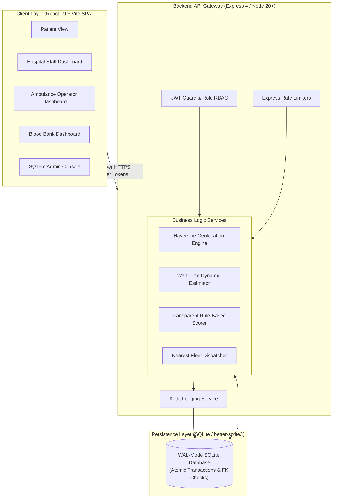
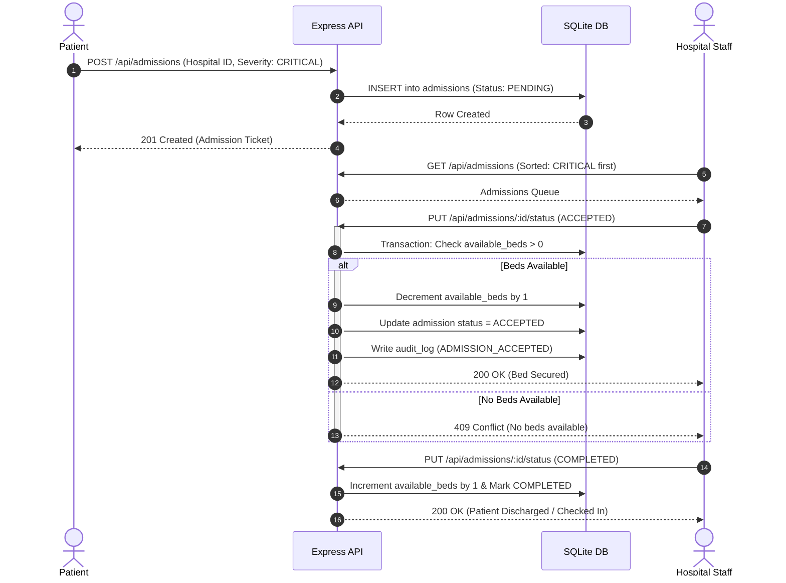
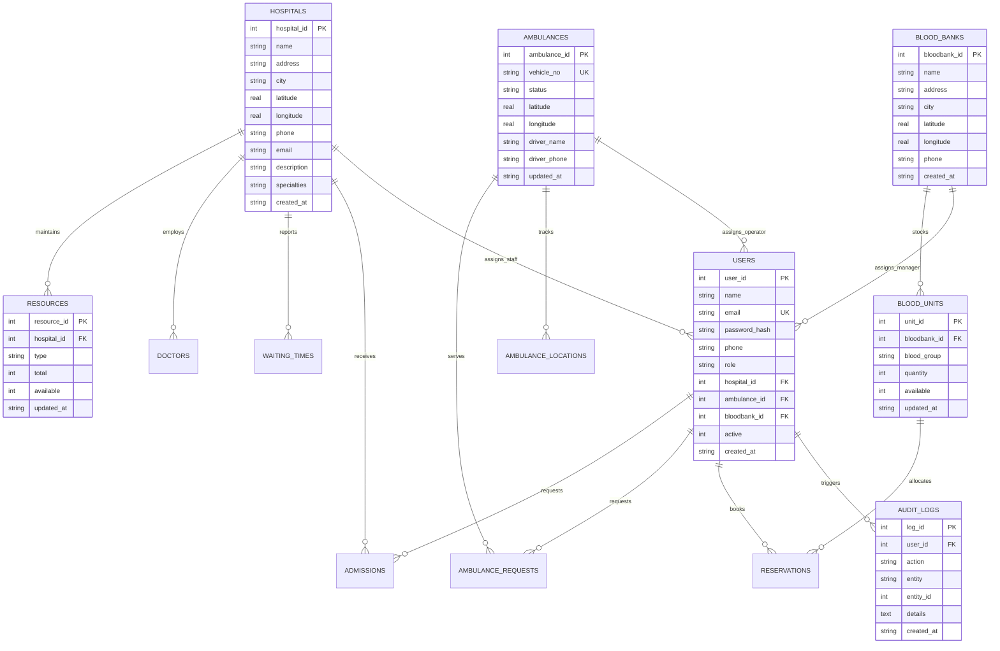

# MediLink — Centralized Healthcare Coordination Platform

[](https://github.com/Khushii1201/MediLink/actions)
[](https://opensource.org/licenses/MIT)
[](https://nodejs.org)
[](https://react.dev)
[](https://vitejs.dev)
[](https://leafletjs.com)

> **MediLink** is a full-stack emergency healthcare coordination platform that bridges patients, hospital facilities, ambulance operators, blood banks, and health authorities into a single, real-time dispatch and resource visibility network.

---

## 1. Problem Statement & Architecture Solution

In metropolitan and semi-urban emergency healthcare, fragmented operations cause critical delays:
1. **Blind Hospital Selection:** Patients visit emergency rooms without knowing bed availability, ICU capacity, or current wait times.
2. **Delayed Emergency Triage:** Emergency wards lack advance notice of incoming critical admissions.
3. **Disconnected Dispatch:** Ambulance operations are fragmented across private and public fleets without unified dispatch algorithms.
4. **Blood Stock Invisibility:** Family members scramble between blood centers during acute shortages.

**MediLink** solves these systemic bottlenecks with a zero-cost, privacy-conscious, rule-based coordination system. It features real-time bed inventory tracking, transparent algorithmic hospital recommendations, nearest-vehicle ambulance dispatch, blood bank reservations, and immutable administrative audit trails.

---

## 2. Key Features Matrix

| Feature | Patient | Hospital Staff | Ambulance Driver | Blood Bank | Administrator |
|---|:---:|:---:|:---:|:---:|:---:|
| **Emergency Facility Discovery & Leaflet Map** | ✅ | ✅ | ✅ | ✅ | ✅ |
| **Multi-Criteria Hospital Recommendation Engine** | ✅ | — | — | — | ✅ |
| **Emergency Admission Request with Triage** | ✅ | — | — | — | — |
| **Admissions Queue (Critical Priority First)** | — | ✅ | — | — | ✅ |
| **Atomic Bed & ICU Stepper Inventory** | — | ✅ | — | — | ✅ |
| **Nearest Available Ambulance Dispatch** | ✅ | — | — | — | ✅ |
| **Live Ambulance Tracking & ETA Broadcast** | ✅ | — | ✅ | — | ✅ |
| **Blood Unit Search & Distance Proximity** | ✅ | — | — | — | ✅ |
| **Blood Reservation Lifecycle (Atomic Hold/Deduct)** | ✅ | — | — | ✅ | ✅ |
| **Staff Provisioning & Role Delegation** | — | — | — | — | ✅ |
| **Full Immutable Audit Trail Stream** | — | — | — | — | ✅ |

---

## 3. System Architecture & Workflows

### 3.1 High-Level Architecture



### 3.2 Emergency Admission & Bed Deduction Flow



### 3.3 Database Schema (Entity-Relationship Diagram)



---

## 4. Algorithmic Models & Mathematical Formulas

### 4.1 Multi-Factor Hospital Recommendation Formula

To prevent arbitrary ranking or opaque black-box AI behavior, MediLink uses a fully transparent, rule-based scoring engine normalized on a scale of `0.0` to `1.0`:

$$\text{Raw Score} = (0.35 \times S_{\text{dist}}) + (0.30 \times S_{\text{beds}}) + (0.20 \times S_{\text{wait}}) + (0.15 \times S_{\text{spec}})$$

Where:
- **Distance Score ($S_{\text{dist}}$):** Calculated using Haversine great-circle distance $d$ in kilometers:
  $$S_{\text{dist}} = \max\left(0, 1 - \frac{d}{50}\right)$$
- **Bed Availability Score ($S_{\text{beds}}$):** Ratio of available beds to total hospital capacity:
  $$S_{\text{beds}} = \frac{\text{available\_beds}}{\max(1, \text{total\_beds})}$$
- **Waiting Time Score ($S_{\text{wait}}$):** Inverse penalty based on dynamic estimated wait minutes:
  $$S_{\text{wait}} = \max\left(0, 1 - \frac{\text{estimated\_wait}}{120}\right)$$
- **Specialty Score ($S_{\text{spec}}$):** $1.0$ if the facility matches the queried medical department, else $0.0$.
- **Specialty Redistribution:** If no specialty is requested by the patient, the $0.15$ specialty weight is proportionally redistributed to distance ($0.40$), availability ($0.35$), and waiting time ($0.25$).
- **Eligibility Gate & Penalty:** Facilities with 0 available capacity receive `hasAvailableCapacity: false`, triggering a severe 0.4 score penalty so available facilities always rank higher.
- **Deterministic Tie-Breaking:** When facilities achieve identical scores, results break ties deterministically by `hospital_id ASC`.
- **Dynamic Narrative Generation (`why_recommended`):** Generates human-readable rationales (e.g., *"Nearest facility (2.4 km away) with 34 beds available (moderate wait ~20 mins)"*).

> **Important Medical Disclaimer:** Recommendation scores and waiting times are algorithmic estimates intended strictly for informational routing and convenience. They do not constitute clinical triage or diagnosis.

### 4.2 Dynamic Emergency Waiting-Time Formula

Emergency department wait times reflect both static queue times and real-time surges in occupancy and critical admissions:

$$\text{Estimated Wait} = \text{Reported Base Wait} \times (1 + \text{Occupancy Factor}) + (5 \times \text{Pending Admissions})$$

Where:
$$\text{Occupancy Factor} = \frac{\text{Total Beds} - \text{Available Beds}}{\max(1, \text{Total Beds})}$$

*Walkthrough Example:*
- Reported baseline wait: 20 minutes
- Hospital beds: 100 total, 20 available $\implies$ Occupancy Factor = $\frac{80}{100} = 0.8$
- Pending triage requests in queue: 3
- $\text{Estimated Wait} = 20 \times (1 + 0.8) + (5 \times 3) = (20 \times 1.8) + 15 = 36 + 15 = \mathbf{51\text{ minutes}}$.

### 4.3 Blood Transfusion Compatibility (ABO / Rh-D Matching)

MediLink implements clinically grounded red blood cell compatibility rules to ensure safe blood product reservations and emergency cross-matching:

| Recipient Blood Group | Compatible Donor Blood Groups | Universal Status |
|:---:|:---|:---:|
| **O-** | O- | Universal Donor (O-) |
| **O+** | O-, O+ | — |
| **A-** | O-, A- | — |
| **A+** | O-, O+, A-, A+ | — |
| **B-** | O-, B- | — |
| **B+** | O-, O+, B-, B+ | — |
| **AB-** | O-, A-, B-, AB- | — |
| **AB+** | O-, O+, A-, A+, B-, B+, AB-, AB+ | Universal Recipient (AB+) |

- **Time-to-Live (TTL) Auto-Expiry:** Stale reservations older than 24 hours in `PENDING` or `APPROVED` states can be expired via `POST /api/bloodbank/reservations/expire`, atomically restoring locked units back to the blood bank's inventory pool.

---

## 5. Technology Stack & Rationale

| Layer | Technology | Version | Engineering Rationale |
|---|---|---|---|
| **Frontend** | React + Vite | React 19.3 / Vite 8.3 | Ultra-fast HMR, concurrent React rendering, sub-second production builds with zero bundle bloat. |
| **Client Routing** | React Router | 7.18 | Modern declarative routing with protected role gates and code-split suspense boundaries. |
| **Mapping Engine** | Leaflet + React-Leaflet | Leaflet 1.9.4 | 100% free, privacy-friendly OpenStreetMap integration centered on Delhi NCR with auto-fit marker bounds. |
| **Backend Runtime** | Node.js + Express | Node 20+ / Express 4.19 | Non-blocking asynchronous I/O, lean RESTful route architecture, lightweight container footprint. |
| **Database** | SQLite (`better-sqlite3`) | better-sqlite3 12.11 | Embedded C-binding engine with zero-latency in-process queries, WAL journaling, and atomic transaction guarantees. |
| **Security** | bcryptjs + jsonwebtoken | bcryptjs 3.0 / jwt 9.0 | Cryptographic password hashing (salt rounds 10), stateless JWT tokens, strict HTTP rate-limiting, and Helmet security headers. |

---

## 6. Local Quickstart

### Prerequisites
- **Node.js**: `v20.0.0` or higher (`node -v`)
- **npm**: `v10.0.0` or higher (`npm -v`)

### Installation & Initialization

1. **Clone the repository:**
   ```bash
   git clone https://github.com/Khushii1201/MediLink.git
   cd MediLink
   ```

2. **Install all dependencies:**
   ```bash
   npm run setup
   ```
   *(Or individually: `npm --prefix backend install` and `npm --prefix frontend install`)*

3. **Seed the database with rich Delhi NCR demo data:**
   ```bash
   npm run seed
   ```

4. **Start concurrent development server:**
   ```bash
   npm run dev
   ```
   - Frontend: [http://localhost:5173](http://localhost:5173)
   - Backend API: [http://localhost:5000](http://localhost:5000)
   - API Health Check: [http://localhost:5000/api/health](http://localhost:5000/api/health)

### Demo Accounts Table

All pre-seeded demo accounts share the password **`password123`**:

| Role | Email Address | Linked Facility | Purpose / Capabilities |
|---|---|---|---|
| **Administrator** | `admin@medilink.com` | Global Network | Full platform oversight, staff provisioning, audit stream, anomaly alerts |
| **Patient** | `patient@medilink.com` | Delhi NCR Resident | Hospital discovery, admission requests, ambulance dispatch |
| **Hospital Staff** | `hospital@medilink.com` | AIIMS New Delhi | Real-time bed stepper, critical admission triage, doctors |
| **Ambulance Driver** | `ambulance@medilink.com` | Vehicle DL-01-AM-1001 | Vehicle status toggle, GPS tracking broadcast, trip steps |
| **Blood Bank Staff** | `bloodbank@medilink.com` | Red Cross Blood Bank | 8-group stock updates, compatibility matching, reservation triage |
| **Second Patient** | `patient2@medilink.com` | Connaught Place | Concurrent booking, ambulance requests, blood reservations |

---

## 7. Testing & Quality Assurance

MediLink includes automated unit, concurrency, and end-to-end backend test suites executed against an isolated in-memory SQLite database (`:memory:`) to guarantee zero regression risk:

```bash
# Run all 4 backend test suites (unit, concurrency, failure/api, e2e):
npm test

# Build frontend production bundle (Vite):
npm run build
```

### Test Suite Breakdown (20 passing tests across 9 suites)

1. **Unit Tests (`backend/tests/unit.test.js`):**
   - Haversine great-circle distance accuracy across Delhi NCR landmarks.
   - Dynamic wait-time formula verifying occupancy surges and queue amplification.
   - Clinical ABO/Rh-D blood compatibility verification for universal donors/recipients.
   - Rule-based anomaly detector for negative inventory, prolonged delays, and depleted reserves.
   - Middleware coordinate bounds checking (-90 to 90, -180 to 180) and phone regex validation.

2. **Concurrency & Race Condition Tests (`backend/tests/concurrency.test.js`):**
   - **Bed Contention Race:** Two concurrent admissions competing for the final available bed. Exactly one receives 200 OK, the other receives 409 Conflict, and `available_beds` never drops below 0.
   - **Ambulance Double-Booking Race:** Two concurrent dispatch requests with only 1 vehicle in the vicinity. Atomic conditional update ensures only one request secures the vehicle; the second is queued.
   - **Blood Stock Over-Allocation Race:** Competing reservations against limited units ensure stock cannot become negative.
   - **Reservation TTL Expiry:** Expired reservations release locked units back to available inventory idempotently.

3. **End-to-End Workflow Tests (`backend/tests/e2e.test.js`):**
   - Complete multi-role lifecycle: Patient Registration $\to$ Explainable Hospital Recommendations $\to$ Emergency Admission $\to$ Nearest Fleet Ambulance Dispatch $\to$ Live GPS Tracking $\to$ Trip Completion $\to$ Immutable Audit Verification.

4. **Integration & Role Guard Tests (`backend/tests/api.test.js`):**
   - Strict RBAC, self-deactivation guards, admission status transitions, and input validation.

---

## 8. Operational Monitoring & Anomaly Detection

MediLink includes an explainable rule-based anomaly detection engine accessible via `GET /api/admin/anomalies` and displayed in the Admin Dashboard **Alerts** tab:

1. **Negative Inventory / Over-Capacity:** Flags resources where `available < 0` or `available > total`.
2. **Duplicate Fleet Assignments:** Flags ambulances marked `BUSY` assigned to multiple `DISPATCHED` or `PICKED_UP` trips concurrently.
3. **Prolonged Pending Admissions:** Detects emergency triage admissions languishing in `PENDING` state for $>60$ minutes.
4. **Prolonged Unassigned Dispatches:** Detects ambulance calls unassigned for $>30$ minutes.
5. **Critically Depleted Blood Reserves:** Flags blood banks with zero units across emergency life-saving groups (O-, O+, AB+).

---

## 9. Demonstration Scenarios for Evaluators / Judges

To evaluate MediLink's capabilities, execute the following 5 real-world scenarios:

### Scenario 1: Multi-Factor Hospital Recommendation & Narrative
1. Log in as `patient@medilink.com` (`password123`).
2. Go to **Find Care** tab. Ensure location is Delhi NCR (e.g., latitude `28.6139`, longitude `77.2090`).
3. View the ranked hospital recommendations. Notice the **Why Recommended** explanation card (e.g., distance, capacity, wait time).
4. Filter by Specialty (e.g., "Cardiology") or Toggle "Beds Only" — observe dynamic score recalculation and eligibility badging.

### Scenario 2: Concurrency-Safe Bed Reservation
1. Open two browser windows:
   - Window A: Log in as `hospital@medilink.com` (AIIMS New Delhi).
   - Window B: Log in as `patient@medilink.com`.
2. As Hospital, navigate to **Resources** and set available General Beds to **1**.
3. As Patient, request an emergency admission for AIIMS New Delhi.
4. As Hospital, click **Accept** on the incoming admission. Notice available beds decrement to **0**.
5. As a second patient (`patient2@medilink.com`), submit an admission request for AIIMS New Delhi. When Hospital attempts to accept, the system rejects it with a **409 Conflict** error ("No available beds in this department"), proving zero negative inventory.

### Scenario 3: Intelligent Ambulance Dispatch & Real-Time Tracking
1. As `patient@medilink.com`, go to the **Ambulance** tab.
2. Click **Request Nearest Ambulance** with your location.
3. The backend calculates Haversine distances to all `AVAILABLE` fleet vehicles and assigns the nearest one (e.g., `DL-01-AM-1001`).
4. In another browser window, log in as `ambulance@medilink.com`.
5. Observe the incoming dispatch ticket. Click **Mark Picked Up** and update coordinates.
6. Switch back to the Patient window: the Leaflet map updates live with the driver's current position, ETA, and status stepper.

### Scenario 4: Blood Compatibility & Inventory Hold Expiry
1. Log in as `patient@medilink.com` and go to **Blood Banks**.
2. Select recipient blood group **A+**. Notice that MediLink displays donor units for **A+, A-, O+, and O-** based on clinical ABO/Rh-D matching.
3. Request 2 units of A+ blood.
4. Log in as `bloodbank@medilink.com` and navigate to **Reservations**. Click **Approve**. Available units decrement immediately.
5. Run stale reservation cleanup (`POST /api/bloodbank/reservations/expire`): any hold older than 24 hours is automatically released back to stock.

### Scenario 5: Operational Anomaly Detection & Immutable Audit
1. Log in as `admin@medilink.com`.
2. Navigate to the **Alerts** tab.
3. View the rule-based anomaly detector results. Notice actionable recommendations with direct entity links.
4. Navigate to the **Audit Logs** tab to inspect the timestamped, immutable chronological event log recording every admission, dispatch, and inventory modification.

# Build frontend production bundle
npm run build
```

---

## 8. Production Deployment

### 8.1 Docker Deployment (Single Container)

MediLink packages frontend and backend into a single multi-stage container:

```bash
# Build Docker image
docker build -t medilink:latest .

# Run container with persistent SQLite volume
docker run -d \
  --name medilink-app \
  -p 5000:5000 \
  -v medilink_data:/data \
  -e JWT_SECRET="your-high-entropy-production-secret-min-32-chars" \
  -e NODE_ENV="production" \
  medilink:latest
```

### 8.2 Render Blueprint (`render.yaml`)

Deploy directly to [Render](https://render.com) using Infrastructure-as-Code:
1. Connect this GitHub repository in Render.
2. Select **Blueprint** deployment.
3. Render automatically provisions a Node web service, mounts a 1 GB persistent disk at `/var/data`, seeds the schema, and configures health checking on `/api/health`.

### Environment Variables Reference

| Variable | Description | Default | Required in Production |
|---|---|---|:---:|
| `PORT` | HTTP server listening port | `5000` | No |
| `NODE_ENV` | Runtime mode (`development`, `test`, `production`) | `development` | Yes |
| `JWT_SECRET` | Secret key for signing authentication tokens | Dev fallback secret | **Yes (min 32 chars)** |
| `DB_PATH` | Path to persistent SQLite database file | `backend/medilink.db` | Optional |
| `CORS_ORIGIN` | Comma-separated allowed CORS origins | `*` | Optional |

---

## 9. Security & Concurrency Architecture

- **Defense in Depth:** Express rate-limiting defends public and login endpoints against brute force attacks. Helmet sets secure headers with open CSP for Leaflet tiles.
- **Role-Based Access Control (RBAC):** Every non-public API endpoint is guarded by `authRequired` and strict `requireRole()` middleware. Staff users are cryptographically bound to their assigned facility ID in the database.
- **ACID Database Transactions:** Critical state transitions (bed decrementing, blood unit deductions, and ambulance assignments) execute within SQLite transactions (`db.transaction()`), preventing race conditions and double-allocation.
- **Immutable Audit Logging:** All state alterations (acceptances, rejections, staff additions, and deactivations) write immutable records to `audit_logs` capturing timestamp, user ID, target entity, and parameters.

---

## 10. License

This project is licensed under the **MIT License** — see the [LICENSE](LICENSE) file for details.
